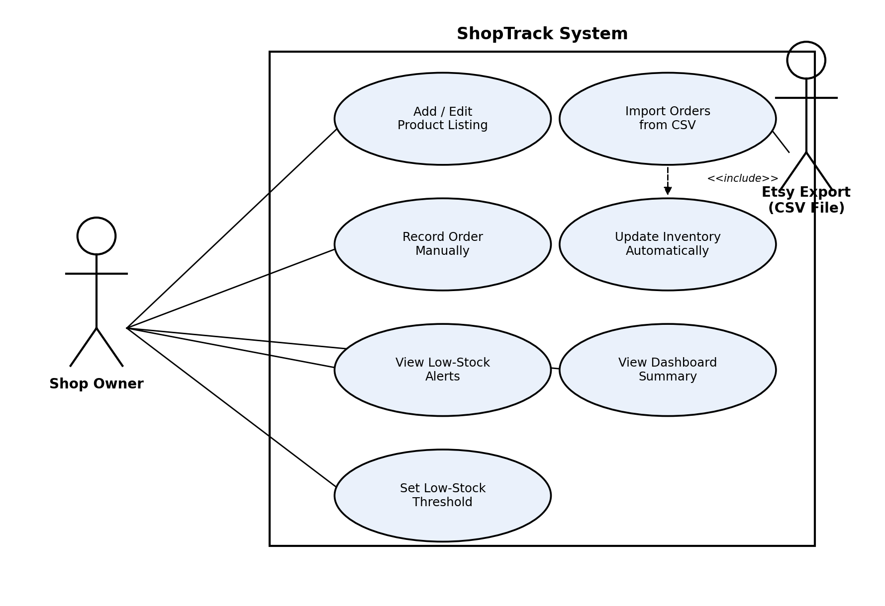
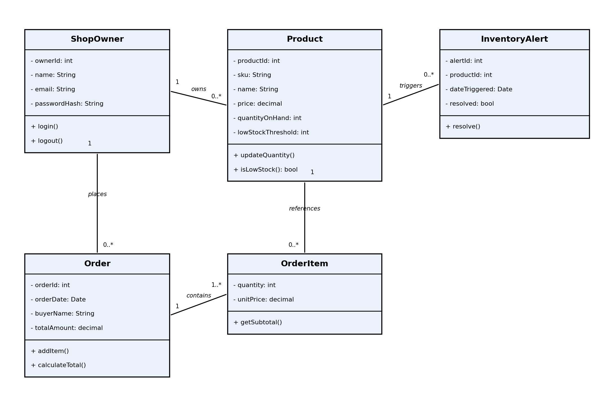
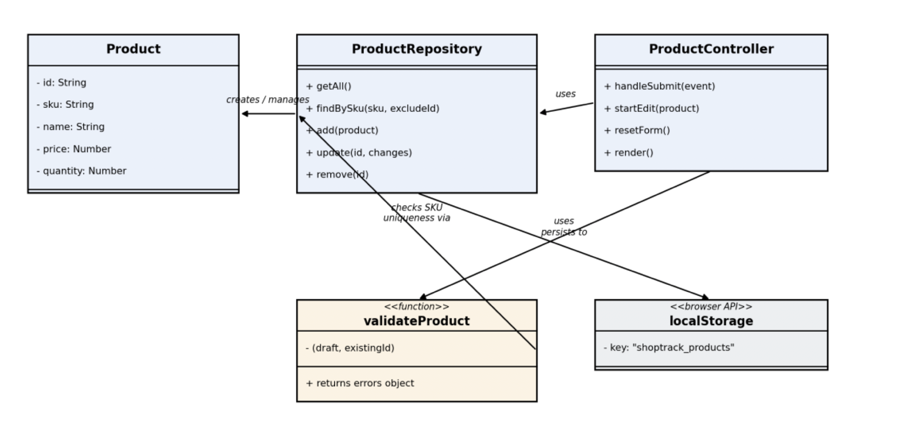
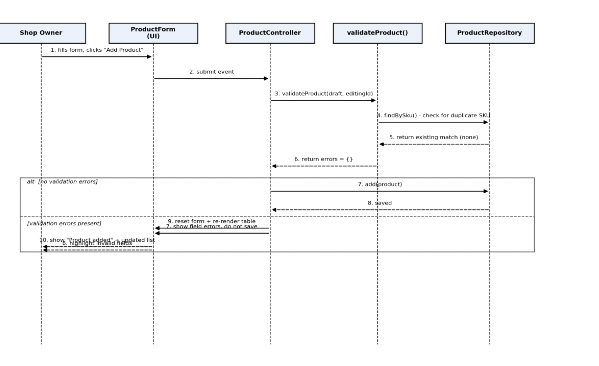

# ShopTrack - Product Listings Prototype

This is a small working prototype of one feature from my ShopTrack backlog
(Assignment 1): **US1 - Add and edit product listings**, tied to FR1.

It's a client-only app - there's no real backend or database. Product data
is saved in the browser's `localStorage`, so it will still be there if you
refresh the page, but it's specific to whatever browser/machine you're using.
That's a known limitation, not a bug - see the reflection section in the
write-up for why I built it this way for a prototype.

## Files

- `index.html` - the page structure (form + product table)
- `style.css` - styling
- `app.js` - all the logic: data model, repository (storage), validation,
  and the controller that wires the form/table to everything else
- `mockup_populated.html`, `mockup_validation.html` - static, non-interactive
  pages used only to generate screenshots for the write-up. They are not
  part of the working app.

## How to run it

You don't need to install anything.

**Option 1 - just open it**
Double-click `index.html` and it'll open in your default browser. That's
enough to use the app.

**Option 2 - run a local server (optional)**
Some browsers restrict `localStorage` for files opened directly from disk.
If you add a product and it doesn't seem to save after a refresh, run a
tiny local server instead:

```
cd shoptrack_prototype
python3 -m http.server 8000
```

Then open `http://localhost:8000` in your browser.

## Design

**Use cases** for the whole ShopTrack system (this prototype covers *Add / Edit Product Listing*):



**Domain model** for the full system:



**Components of this prototype.** `ProductRepository` is the only piece that talks to
`localStorage`, `validateProduct` is a pure function with no DOM or storage access, and
`ProductController` connects the form and table to both:



**Add Product flow**, including the validation-error path:



## What it does

- Add a new product with a SKU, name, price, and quantity on hand
- Edit an existing product (click "Edit" on any row)
- Delete a product (click "Delete" on any row)
- Form validation: SKU and name are required, SKU must be unique, price and
  quantity must be zero or more
- Data persists in `localStorage` between page refreshes

## What it does not do (out of scope for this prototype)

- No real backend, database, or multi-user support
- No CSV import (that's US2, a separate backlog item)
- No low-stock alerts (that's US4)
- No login/authentication (that's US6 / NFR2)

These are all separate stories in the backlog and would each get their own
design-and-build pass in a real sprint.

## Author

**Ousmana Tunkara** · [GitHub @Kodelack47](https://github.com/Kodelack47)

Licensed under the [MIT License](LICENSE).
